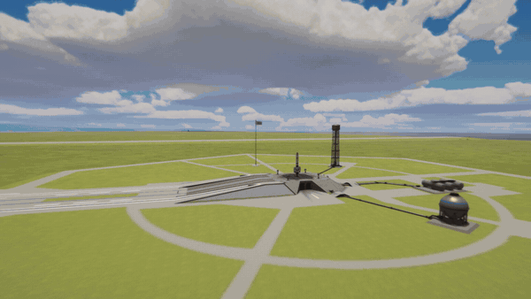
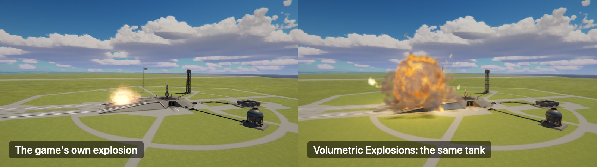
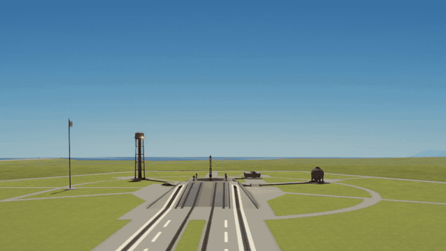
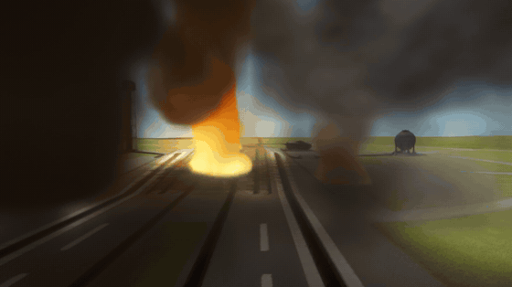

# Volumetric Explosions

The game's flat explosion sprites replaced by a small simulation of fire, smoke and dust, drawn as a true volume and
lit by the sun, the sky and the fire. It changes nothing but the look.

*Left: the game's own explosion. Right: the same blast with the mod.*

For Kerbal Space Program 1.12.x. It needs no other mod, and works with [BD Armory](https://github.com/BrettRyland/BDArmory) (0.10.0).

## What you get

* **What blew up decides the look:** fuel gives an orange fireball and thick dark smoke, solid propellant a white
  flash and pale smoke, a battery a blue-white flash. So does where: thin air, a vacuum, night.
* **Smoke that behaves like smoke:** it rises and rolls, drifts on the wind, lies on the ground, goes round buildings
  and is pushed about by craft.
* **Shock fronts, pieces and burn marks,** shadows under the smoke, and fires that burn on where fuel was spilt; a big
  blast's front lifting a ring of dust off bare ground, pieces throwing up dust or spray where they land, burn marks
  as real ones look, lopsided and streaked with soot, no two alike (0.8.0).
* **BD Armory's explosions** (0.10.0): with BD Armory installed, its shells, rockets, missiles and bombs go off as this
  mod's, each sized by the explosive in it: a shell's dark puff that hangs where it burst, a bomb's flash, shock front and
  brown cloud of earth thrown up out of its crater. Its sound and its damage stay its own.
  [More](https://github.com/IshiakiZ/ksp-volumetric-explosions/wiki/What-decides-how-an-explosion-looks#bd-armorys-explosions-0100).
* **BD Armory's fire and smoke** (0.10.0): a burning part's fire and its smoke, a holed tank's spray, a missile's flame and the
  trail it leaves hanging, rockets' trails, guns' smoke, the puff and sparks where a shot strikes, flares, smoke screens and
  chaff, drawn as volumes too; with [Natural Ocean](https://github.com/IshiakiZ/ksp-natural-ocean), its rounds' splashes into the sea. Alt-B
  (Option-B on a Mac) flips between these and BD Armory's own. Only the look is changed.
  [More](https://github.com/IshiakiZ/ksp-volumetric-explosions/wiki/BD-Armory).
* **Embers** (0.10.0): a fire on the ground sends up glowing bits that drift on its heat, dim and go out.
* **A nuclear explosion** (0.10.0): the flash and the light it throws, a fireball that rises into a mushroom cloud standing
  for minutes, its stem of dust and the dust its blast lifts off the ground, and a scorch mark where it was near the ground,
  worked out from the physics of a real one and judged against photographs of the tests. Nothing in the stock game is a
  nuke: it goes off for BD Armory's.
* **Its own bang** (0.8.0): a crack close by, a boom and a long rumble far off, as big as what went off, heard when its
  sound gets to you.
* **Other mods' resources** count as the stock ones they are like, for what each is worth beside it (liquid hydrogen as
  fuel with a clear flame, liquid oxygen as oxidiser, argon as xenon, and so on): `PluginData/resources.cfg` lists all of
  the Community Resource Pack's. With RealBattery, a battery's charge counts for all it holds. (By Rjoande.)
* **Engines' flames and smoke,** with [Engine Flames](https://github.com/IshiakiZ/ksp-engine-flames) and
  [Rocket Smoke](https://github.com/IshiakiZ/ksp-rocket-smoke), which are made in the same air.

## Install

Copy the `VolumetricExplosions` folder from the download into your KSP's `GameData`. To remove it, delete that folder.

On a Mac, a copy downloaded with a browser runs slower until you allow its library with one command: see
[Installing](https://github.com/IshiakiZ/ksp-volumetric-explosions/wiki/Installing).

## Settings

In `GameData/VolumetricExplosions/PluginData/settings.cfg`: `quality` (0.2 light to 3 heavy), `size`, `smoke` (how
long it hangs), `wind`, `blasts_push = true` for blasts that push craft and break what they knock too hard (0.9.0; off as
it comes), `bdarmory = false` for BD Armory's own explosions and `armory = false` for the rest of its effects as it draws them (0.10.0), and `enabled = false` for the game's own explosions.
Since 0.10.0 they are on a page of Keystone's window too, where Keystone is installed (a change there is written into the
file), with the finer ones (among them how bright and how tall a fire's flames are, and how long engines' trails stay) in
its Advanced view. [All of them](https://github.com/IshiakiZ/ksp-volumetric-explosions/wiki/Settings).

## Good to know

* What it costs: a 4-tonne fuel fire filling half the view took the game from 79 frames a second to 56 at first and
  70 to 75 once it was smoke (an Apple M5 Pro), and from 165 to 141 on an NVIDIA RTX 4080 SUPER, both at 1280 x 720.

## Works on

Mac: tried. Windows 11 (Direct3D 11 and OpenGL): 0.8.0 tried (launches, crashes, the fire's mended light, the smoke standing at a fire); 0.9.0's fireball laid over two frames made and filmed there, its blasts that push tried there; 0.10.0's BD Armory explosions made and filmed there on OpenGL and Direct3D, its embers on OpenGL, its nuclear explosion on Direct3D. Its shaders' changes since 2026-10-26 have not been packed for OpenGL (a Mac, Linux), where 0.10.0 is untried. Linux: never run.

**More:** [the long description](https://github.com/IshiakiZ/ksp-volumetric-explosions/wiki/The-long-description) (everything in full,
and what was tried on each system) and the rest of the [wiki](https://github.com/IshiakiZ/ksp-volumetric-explosions/wiki).

## Licence

[CC BY 4.0](LICENSE): use it, change it and pass it on as you like, as long as you credit Ishiaki and link back here.
