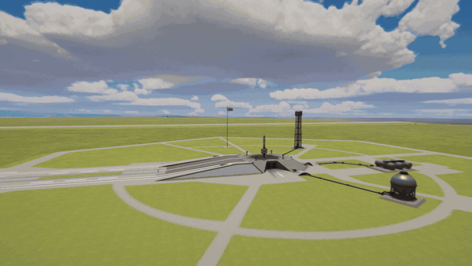
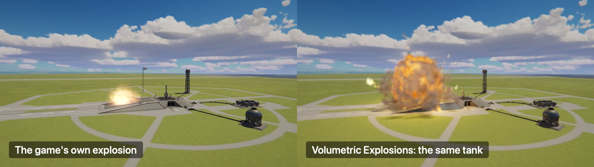

# Volumetric Explosions

The game's flat explosion sprites replaced by a small simulation of fire, smoke and dust, drawn as a true volume and
lit by the sun, the sky and the fire. It changes nothing but the look.

*Left: the game's own explosion. Right: the same blast with the mod.*

For Kerbal Space Program 1.12.x. It needs no other mod.

## What you get

* **What blew up decides the look:** fuel gives an orange fireball and thick dark smoke, solid propellant a white
  flash and pale smoke, a battery a blue-white flash. So does where: thin air, a vacuum, night.
* **Smoke that behaves like smoke:** it rises and rolls, drifts on the wind, lies on the ground, goes round buildings
  and is pushed about by craft.
* **Shock fronts, pieces and burn marks,** shadows under the smoke, and fires that burn on where fuel was spilt.
* **Engines' flames and smoke,** with [Engine Flames](https://github.com/IshiakiZ/ksp-engine-flames) and
  [Rocket Smoke](https://github.com/IshiakiZ/ksp-rocket-smoke), which are made in the same air.

## Install

Copy the `VolumetricExplosions` folder from the download into your KSP's `GameData`. To remove it, delete that folder.

On a Mac, a copy downloaded with a browser runs slower until you allow its library with one command: see
[Installing](https://github.com/IshiakiZ/ksp-volumetric-explosions/wiki/Installing).

## Settings

In `GameData/VolumetricExplosions/PluginData/settings.cfg`: `quality` (0.2 light to 3 heavy), `size`, `smoke` (how
long it hangs), `wind`, and `enabled = false` for the game's own explosions.
[All of them](https://github.com/IshiakiZ/ksp-volumetric-explosions/wiki/Settings).

## Good to know

* What it costs: a 4-tonne fuel fire filling half the view took the game from 79 frames a second to 56 at first and
  70 to 75 once it was smoke (an Apple M5 Pro), and from 165 to 141 on an NVIDIA RTX 4080 SUPER, both at 1280 x 720.

## Works on

Mac: tried. Windows 11 (Direct3D 11 and OpenGL): 0.6 tried; this version built for it, not run there. Linux: never run.

**More:** [the long description](https://github.com/IshiakiZ/ksp-volumetric-explosions/wiki/The-long-description) (everything in full,
and what was tried on each system) and the rest of the [wiki](https://github.com/IshiakiZ/ksp-volumetric-explosions/wiki).

## Licence

[CC BY 4.0](LICENSE): use it, change it and pass it on as you like, as long as you credit Ishiaki and link back here.
