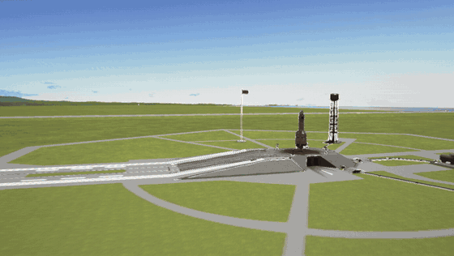
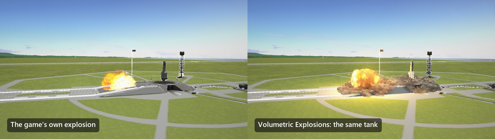
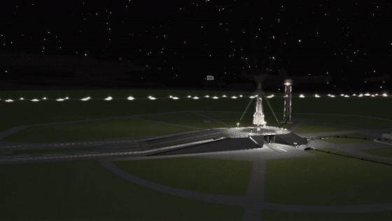
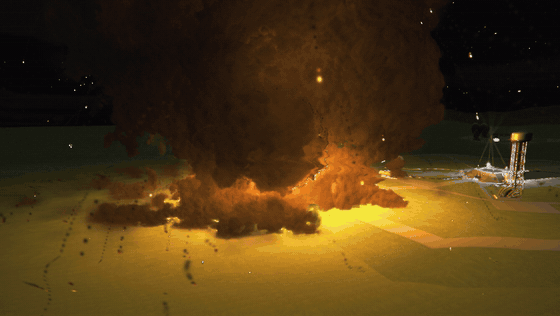
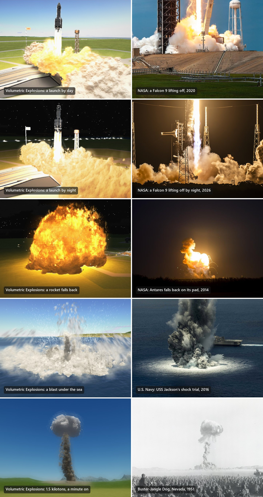

# Volumetric Explosions

The game's flat explosion sprites replaced by a small simulation of fire, smoke and dust, drawn as a true volume and
lit by the sun, the sky and the fire. It changes nothing but the look.

*Left: the game's own explosion. Right: the same blast with the mod.*

*Left, this mod; right, what it was set against: NASA's photographs of a Falcon 9 lifting off by day (Crew Dragon
Demo-2, 2020) and by night (2026) and of Antares falling back on its pad (2014), the U.S. Navy's of USS Jackson's shock
trial (2016), and the Buster-Jangle Dog test (Nevada, 1951), a U.S. government photograph. The launches are with Engine
Flames, Rocket Smoke and Natural Light; the nuclear cloud is BD Armory's 1.5 kilotons.*

For Kerbal Space Program 1.12.x. It needs no other mod, and works with [BD Armory](https://github.com/BrettRyland/BDArmory) (0.10.0).

## What you get

* **What blew up decides the look:** fuel gives an orange fireball and thick dark smoke, solid propellant a white
  flash and pale smoke, a battery a blue-white flash. So does where: thin air, a vacuum, night.
* **Smoke that behaves like smoke:** it rises and rolls, drifts on the wind, lies on the ground, goes round buildings
  and is pushed about by craft.
* **Shock fronts, pieces and burn marks,** shadows under the smoke, and fires that burn on where fuel was spilt; a big
  blast's front lifting a ring of dust off bare ground, pieces throwing up dust or spray where they land, burn marks
  as real ones look, lopsided and streaked with soot, no two alike (0.8.0).
* **BD Armory's explosions** (0.10.0): with BD Armory installed, its shells, rockets, missiles and bombs go off as this
  mod's, each sized by the explosive in it: a shell's dark puff that hangs where it burst, a bomb's flash, shock front and
  brown cloud of earth thrown up out of its crater. Its sound and its damage stay its own.
  [More](https://github.com/IshiakiZ/ksp-volumetric-explosions/wiki/What-decides-how-an-explosion-looks#bd-armorys-explosions-0100).
* **BD Armory's fire and smoke** (0.10.0): a burning part's fire and its smoke, a holed tank's spray, a missile's flame and the
  trail it leaves hanging, rockets' trails, guns' smoke, the puff and sparks where a shot strikes, flares, smoke screens and
  chaff, drawn as volumes too; with [Natural Ocean](https://github.com/IshiakiZ/ksp-natural-ocean), its rounds' splashes into the sea. Alt-B
  (Option-B on a Mac) flips between these and BD Armory's own. Only the look is changed.
  [More](https://github.com/IshiakiZ/ksp-volumetric-explosions/wiki/BD-Armory).
* **Embers** (0.10.0): a fire on the ground sends up glowing bits that drift on its heat, dim and go out.
* **A nuclear explosion** (0.10.0): the flash and the light it throws, a fireball that rises into a mushroom cloud standing
  for minutes, its stem of dust and the dust its blast lifts off the ground, and a scorch mark where it was near the ground,
  worked out from the physics of a real one and judged against photographs of the tests. Nothing in the stock game is a
  nuke: it goes off for BD Armory's.
* **Blasts bring buildings down** (0.12.0): a blast strong enough where a building of the space centre stands wrecks it
  as its front arrives: a nuclear explosion for hundreds of metres or kilometres round (20 kilotons between the pad and
  the assembly building leaves nine of the centre's 39 buildings standing), a big rocket going up on the pad within some
  tens of metres. The game's own collapse and repair; `blasts_raze = false` turns it off.
* **Sharper smoke, blacker soot** (0.12.0): a blast's smoke stands in billows, where it was soft as cotton wool; a
  fuel fire's soot is black over its fire; the burning pieces a blast throws are each a little fire at the head of a
  thin line of smoke, no two alike, as in NASA's photographs of Antares in 2014; and smoke that stays where it is is
  drawn at the screen's full size for as long as the game holds 50 frames a second (`sharp_when_fast`, `sharp_fps`), at
  half size on a machine that cannot.
* **Smoke that changes in every frame** (0.12.0): the smoke's grids are made anew some eight to twenty-five times a
  second, and each new one used to come in a step, so that in a game drawing many more frames than that a fire and its
  smoke had a frame rate of their own. The smoke, its billows, its light, its fire and its shadow on the ground now go
  over from each grid to the next. Counted on a burning wreck with a grid to every seven frames: an eighth of the moving
  picture stepped before, under a hundredth after.
* **A crash is one fire** (0.12.0): a rocket that falls on the ground goes up tank by tank, a dozen blasts within a
  second. They are now one fireball, as wide and burning as long as all their fuel together makes it (67 tonnes: some
  ninety metres across, glowing for its first seconds, black smoke by seven, a column climbing after), where each was
  a small fireball of its own that flung the ones before it apart: scraps of flame and smoke in a ring three hundred
  metres wide. A big fire's smoke is as thick as a small one's (it was a brown fog the ground showed through), the
  shaded side of a cloud shows its billows by the sky's light, and the smoke round a fire is lit and shaded by it,
  billow by billow. Smoke drawn at half size, as a busy scene's is, is enlarged more keenly.
* **A crash's fire stays with the wreck** (0.12.0): the game's physics can throw a part at thousands of metres a
  second for the instant before it breaks (seen with a rocket moved hard while its launch clamps held it), and a blast
  took that for the wreck's speed: the sky over the crash was strewn with balls of fire for hundreds of metres. A
  breaking part now goes no faster than its craft can have been going, and a blast that went off under the ground (a
  part pushed through the runway) is put on the ground over it. Set beside NASA's crash test of an airliner in 1984:
  one fire that darkens and climbs as black smoke.
* **An empty part does not burn** (0.12.0): a part with nothing in it that breaks by striking something, or that the
  physics flings, throws up its pieces and dust and no fire; each went with a small bang of its own, and an emptied
  rocket slid along the runway went up in a wall of fire. Set beside NASA's drop of an empty helicopter airframe in
  2013: a little dust. The dust off the runway and the pads is pale concrete's, where it was near black. Metal struck
  or dragged along the ground throws orange sparks low and on ahead with the wreck, which can be seen from afar at
  night (they were cream, thrown up all round, and too fine to be seen from sixty metres).
* **Buildings come down in dust** (0.12.0): a building of the space centre that comes down, by a blast or by being
  struck, goes in grey dust at its foot, as tall as it stood and all along it, which hangs for half a minute; the
  game's own explosions a hundred metres wide, its fire and its black smoke over a building are taken away. Set beside
  NASA's photographs of the Cape's towers brought down.
* **Smoke has a surface** (0.12.0): young, thick smoke ends at a hard edge, lobe upon rounded lobe, as a real launch
  cloud and a fuel fire's black smoke do; it was a soft mound with a fringe one saw into. Thin trails, stray puffs and
  old smoke still thin away. Its domes are larger, with the small billows as a texture on them, and it is lit and shaded
  dome by dome; a fuel fireball is yellow at its heart and its smoke black; a nuclear explosion's cap is a crust of
  lobes on a ropy stem. A launch's cloud of steam climbs and stands for half a minute. Each judged against photographs:
  NASA's of launch clouds and of a jet-fuel fireball, and the Nevada tests'.
* **Smoke that pours has its billows** (0.12.0): the smoke streaming from an engine, and a fire's column, showed one
  lump of the billows all along the stream: a rocket's cloud on its pad was smooth and soft, combed into fibres outward
  from the pad. Its billows now lie along the stream as well as across it, and go out with the smoke. A rocket's pale
  smoke has a little more light and shade with them: grey under its billows, where it was white on white.
* **Launches set beside NASA's photographs** (0.12.0): steam boils up off the pad's deck round the rocket's base as well
  as out of the trench's ends, and the flame lights it from all along its length: by day the base stands in steam lit
  gold and orange, white further off, and by night the steam is cream where brightest and brown in shade, its far sides
  and clefts in shadow, and stays lit as the rocket climbs away, as in NASA's photographs of the Falcon 9 by night (it
  was white all over, the flame's light coming up weakly from down in the trench). The floodlights' light on the smoke
  is shaded by its billows, so no dark smoke shows through the light grey. A solid booster's column goes soft as it
  spreads; an engine's plume opens wide in thin air.
* **Rocket fire as a Falcon 9's** (0.12.0, with [Engine Flames](https://github.com/IshiakiZ/ksp-engine-flames)): a kerosene engine's flame
  is white at its core and orange round it, as in NASA's film of Demo-2, where it was white with a white glow; it glows
  on yellow and orange as it cools, and its far end boils.
* **Blasts at sea set beside the Navy's** (0.12.0): a blast at sea throws its water up in jets, fingers of spray
  streaking up out of its white dome, as in the Navy's photographs of its shock trials (it was a soft white ball); the
  streaks stay beside the column and fall there, and its mist runs out low along the water in a widening ring, as round
  the foot of the column in the Navy's film of the USS Jackson. A warhead's under the water sends its gas up through
  the dome, grey with its smoke.
* **Behind Blackrack's clouds** (0.12.0): beside his volumetric clouds, smoke that lies behind a cloud is hidden by it
  as the ground is (a far mushroom cloud stood in front of the cloud and haze that veiled the ground it stood on).
* **The bang when its sound gets to you:** the game's own bang, held back a second for every 340 metres. The mod makes
  no sound of its own (0.11.0: the bang it made from 0.8.0 to 0.10.0 is taken out).
* **Other mods' resources** count as the stock ones they are like, for what each is worth beside it (liquid hydrogen as
  fuel with a clear flame, liquid oxygen as oxidiser, argon as xenon, and so on): `PluginData/resources.cfg` lists all of
  the Community Resource Pack's. With RealBattery, a battery's charge counts for all it holds. (By Rjoande.)
* **Engines' flames and smoke,** with [Engine Flames](https://github.com/IshiakiZ/ksp-engine-flames) and
  [Rocket Smoke](https://github.com/IshiakiZ/ksp-rocket-smoke), which are made in the same air.

## Install

Copy the `VolumetricExplosions` folder from the download into your KSP's `GameData`. To remove it, delete that folder.

This version's download carries the mod's own fast library for Windows. On a Mac and on Linux it does its heaviest sums
with its own code, slower; 0.9.0 is the last version made and tried on a Mac
([Installing](https://github.com/IshiakiZ/ksp-volumetric-explosions/wiki/Installing)).

## Settings

In `GameData/VolumetricExplosions/PluginData/settings.cfg`: `quality` (0.2 light to 3 heavy), `size`, `smoke` (how
long it hangs), `wind`, `blasts_push = true` for blasts that push craft and break what they knock too hard (0.9.0; off as
it comes), `bdarmory = false` for BD Armory's own explosions and `armory = false` for the rest of its effects as it draws them (0.10.0), and `enabled = false` for the game's own explosions.
Since 0.10.0 they are on a page of Keystone's window too, where Keystone is installed (a change there is written into the
file), with the finer ones (among them how bright and how tall a fire's flames are, and how long engines' trails stay) in
its Advanced view. [All of them](https://github.com/IshiakiZ/ksp-volumetric-explosions/wiki/Settings).

## Good to know

* What it costs: a 4-tonne fuel fire filling half the view took the game from 79 frames a second to 56 at first and
  70 to 75 once it was smoke (an Apple M5 Pro), and from 165 to 141 on an NVIDIA RTX 4080 SUPER, both at 1280 x 720.
  0.12.0 on that card, among a dozen other mods: from 137 to 86 over the blast's first eight seconds and 79 over the
  next eight, where the build before these changes had 72 and 65. The space plane hangar coming down, seen whole from
  half a kilometre: from 63 frames a second to 50 to 53 for three seconds and 55 to 59 after, where the game's own
  collapse kept 62 to 70.

## Works on

Mac: tried. Windows 11 (Direct3D 11 and OpenGL): 0.8.0 tried (launches, crashes, the fire's mended light, the smoke standing at a fire); 0.9.0's fireball laid over two frames made and filmed there, its blasts that push tried there; 0.10.0's BD Armory explosions made and filmed there on OpenGL and Direct3D, its embers on OpenGL, its nuclear explosion on Direct3D; 0.11.0 and 0.12.0 made and filmed there on Direct3D. Its shaders' changes since 2026-10-26 have not been packed for OpenGL (a Mac, Linux), where 0.10.0 to 0.12.0 are untried. Linux: never run.

**More:** [the long description](https://github.com/IshiakiZ/ksp-volumetric-explosions/wiki/The-long-description) (everything in full,
and what was tried on each system) and the rest of the [wiki](https://github.com/IshiakiZ/ksp-volumetric-explosions/wiki).

## Licence

[CC BY 4.0](LICENSE): use it, change it and pass it on as you like, as long as you credit Ishiaki and link back here.
